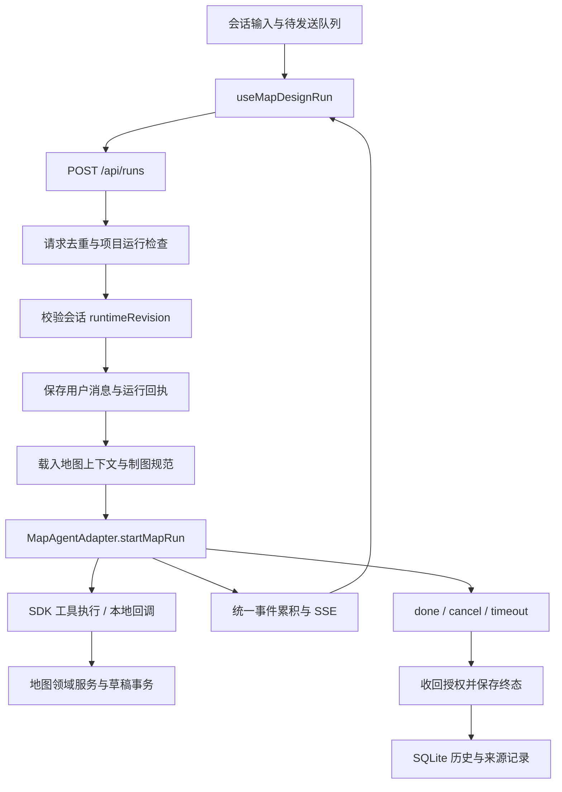

# MapDesign agent 调度审查

审查日期：2026-09-26。代码基线：`d041528d99`。使用 `ponytail:ponytail-audit` 和 `coding-standards` 中的 TypeScript、异步控制流、类型边界与可维护性规则。

后续发布准备已消除本文记录的 guard 误报，并补充浏览器及 macOS 安装验证，见 [0.1.2 发布准备验证](2026-09-26-release-0.1.2.zh-CN.md)。下文保留各阶段原始结果。

本次先扫描仓库入口、依赖和引用，再深读 Web 会话队列、daemon 运行服务、原生 agent 适配器、工具运行时、会话恢复和持久化历史。这里的结论针对实际读到的调用链与执行过的测试，并非对仓库每一行代码的完整证明。初次审查保留业务实现并新增使用文档；随后按用户要求修复了三个问题，交付和验证记录见第 8 节。精简项仍为建议值。

## 1. 结论与优先顺序

基线确认 3 个 P2 调度问题：前端断流恢复无法持续跟踪活动任务；超时释放运行状态早于执行器清理；前端请求 ID 在多客户端之间可能碰撞。三个问题现已修复，并新增正式回归测试。第 3 节保留原始触发条件与复现证据，其中行号对应审查基线。

现有分层有清楚的作用：项目级运行协调、会话运行时版本校验、原生适配器接口、工具去重、终态回放和 SQLite 运行记录共同构成制图执行链。边界问题已优先修复，遗留参数和重复函数可按第 4 节继续整理。现有需求可以继续由本地服务和小型状态管理承担。

## 2. 调度链路



| 层次 | 当前职责 | 关键代码 |
| --- | --- | --- |
| 会话消息队列 | 按顺序派发、编辑待发送项、失败或取消后暂停 | [`useQueuedMapMessages.ts`](../../apps/web/src/map-design/chat/useQueuedMapMessages.ts) |
| Web 运行状态 | 发送、接收 SSE、取消、查询回补、释放下一轮发送条件 | [`useMapDesignRun.ts`](../../apps/web/src/map-design/chat/useMapDesignRun.ts) |
| 运行时选择 | 每会话持久化选择，用修订号比较并更新，返回当前有效配置 | [`conversation-runtime-service.ts`](../../apps/daemon/src/map-design/application/conversation-runtime-service.ts) |
| 运行协调 | 项目级排他、请求回放、上下文装配、超时、终态和关闭 | [`run-service.ts`](../../apps/daemon/src/map-design/application/run-service.ts) |
| 适配器 | 各 agent 的协议握手、工具事件、会话续接和进程停止 | [`agents/types.ts`](../../apps/daemon/src/map-design/agents/types.ts)、[`local-agent-registry.ts`](../../apps/daemon/src/map-design/application/local-agent-registry.ts) |
| 工具执行 | 运行身份校验、调用 ID 去重、结果约束和运行关闭 | [`sdk-tool-runtime.ts`](../../apps/daemon/src/map-design/agents/sdk-tool-runtime.ts) |
| 持久化 | 请求 ID/摘要回执、最终消息、来源、启动时中断恢复 | [`run-history.ts`](../../apps/daemon/src/map-design/storage/run-history.ts) |

同一项目的运行检查位于 daemon，前端队列决定当前页面下一条消息何时提交。会话切换时，活动会话与待发送项由 `MapDesignChatPane` 保留。API Model 内部对地图工具使用 Promise 顺序链；各原生适配器的调度则遵循自己的协议与生命周期。

## 3. TypeScript 与常规正确性审查

### P2-1：断流时仍在运行的任务会让前端一直保持忙碌

位置：[`useMapDesignRun.ts`](../../apps/web/src/map-design/chat/useMapDesignRun.ts)，46–62、213–247 行。

触发条件：SSE 在收到 `run_finished` 之前结束或抛错，随后查询 `/api/runs/:id` 时任务仍为 `running`。

`reconcile()` 把 `recoveryRef.current` 设为 `true`，执行一次运行/会话查询后结束。若返回运行中，`terminalRef` 保持 `false`；收流代码的 `finally` 只在终态释放 `controllerRef`、`activeRunRef` 和 `ready`。此时既没有新事件订阅，也没有后续轮询，任务后来完成的状态无法再进入该 hook。取消请求失败后回补为 `running` 的路径也存在相同恢复需求。

影响：页面保持运行中，待发送队列等不到 `ready`，新的 `send()` 返回 `false`。手动再查询、取消或重新进入页面才可能使显示回到实际状态。

复现证据：测试让事件流立即关闭，第一次查询返回 `running`，随后把服务端状态改为 `succeeded` 并推进 60 秒。结果仍为 `status=running`、`ready=false`，第二条消息发送失败；事件订阅和状态查询均只有一次。

建议：为断流后的活动运行增加有界重连或状态轮询，直到终态或组件卸载。并发回补锁在 `finally` 释放，并通过运行 ID / 请求代次忽略旧响应。终态统一释放发送条件，让队列自然恢复。增加“断流 → 运行中 → 稍后完成”及“取消失败 → 稍后完成”的回归场景。

### P2-2：超时后先释放项目，旧执行器仍可能处于清理中

位置：[`run-service.ts`](../../apps/daemon/src/map-design/application/run-service.ts)，228–238 行；相关检查位于 299–301、520–521、568–572 行。

触发条件：无活动超时到达，适配器的 `cancel()` 仍在等待模型请求或进程树停止。

`timeoutRun()` 启动 `cancel()` 后立即调用 `finish()`，后者将 `terminal` 设为 `true`。项目运行检查只认 `!terminal`，因此马上允许同项目下一轮。`shutdown()` 同样只等待非终态运行；已经超时但仍在停止中的 Promise 被跳过。生产环境还会从活动表驱逐完成记录。

影响：相同项目的新执行器可以与旧执行器的清理阶段重叠，应用关闭也可能先于适配器停止完成。会话和工作目录相同的本地进程尤其需要清楚的停止顺序。

已核对的边界：`finish()` 会立即关闭工具运行时并撤销回调令牌。这里确认的是执行器生命周期与项目调度条件不一致，并未证明旧执行器能够继续通过已撤销授权修改地图。

复现证据：适配器返回尚未完成的 `done`，`cancel()` 等待该 Promise。推进 51 ms 触发配置为 50 ms 的超时后，第一轮为失败、停止完成数为 0、`isProjectRunning()` 已为 `false`。第二轮成功进入相同项目；第二轮超时后，`shutdown()` 在停止完成数仍为 0 时返回。

建议：允许及时展示失败并撤销工具授权，同时单独保留“执行器停止中”的项目占用及清理 Promise。下一轮入场、活动记录驱逐和关闭等待都要考虑这一状态；适配器维持有界停止逻辑。测试应分别控制“取消已请求”和“进程已退出”。

### P2-3：按时间与组件计数生成的 ID 会在多客户端碰撞

位置：[`useMapDesignRun.ts`](../../apps/web/src/map-design/chat/useMapDesignRun.ts)，110–120 行。

触发条件：两个页面或两个独立 hook 实例在同一毫秒进行相同序号的发送，例如各自首次提交。

当前 nonce 是 `Date.now()` 与组件内 `sequenceRef` 的拼接。计数器在每个实例内从零开始，所以不同项目也会得到相同的 `clientRequestId`、`userMessageId` 和 `assistantMessageId`。

daemon 的请求去重键是全局 `clientRequestId`，持久化表也对其施加 `UNIQUE`。不同请求摘要会触发冲突；同一个请求被碰撞命中时，则可能被当作旧请求回放。

复现证据：固定毫秒时钟，创建不同项目的两个 hook 并同时发送。捕获到的两份请求项目 ID 不同，而上述三个 ID 完全相同。daemon 对重复请求 ID / 不同摘要的拒绝路径已存在，见 [`run-service.ts`](../../apps/daemon/src/map-design/application/run-service.ts) 281–290 行及 [`run-history.ts`](../../apps/daemon/src/map-design/storage/run-history.ts) 28–35 行。

建议：使用项目现有 [`randomUUID()`](../../apps/web/src/utils/uuid.ts) 为逻辑请求生成 ID，或以一个 UUID 派生三种消息/请求 ID。相同逻辑请求的传输重试保留原 ID；新的用户提交生成新 ID。

## 4. Ponytail 精简清单

以下仅衡量复杂度与可删除代码，按预计净减少量排序。行数是保守估算，包含替代函数和必要导入的成本，不计算尚未整理的测试数量。

- shrink: 合并两个 CLI 完全重复的 UTF-8 提示词限长读取器，预计净减约 27 行。用一个 `readPromptInput(path, io)`，共享 16,384 字符 / 64 KiB 边界及可识别的输入错误。[`map-design-cli.ts:204`](../../apps/daemon/src/map-design-cli.ts) 与 [`tools-map-design-project-cli.ts:154`](../../apps/daemon/src/tools-map-design-project-cli.ts)。
- delete: 删除运行服务不消费的 `mcpCliPath` 启动传参链及其前置文件检查，预计净减约 24 行。替代：无；保留供集成使用的 MCP CLI 实际入口。[`server.ts:44`](../../apps/daemon/src/server.ts)、[`run-service.ts:67`](../../apps/daemon/src/map-design/application/run-service.ts)。
- delete: 删除生产路径没有调用的 `normalizeLocalAgentFailure()` 与其专用 `record()`，预计净减约 21 行。替代：把仍有价值的错误归一化验证放到现用适配器；该旧转换器当前调用者仅在测试。[`run-service.ts:605`](../../apps/daemon/src/map-design/application/run-service.ts)。
- delete: 移除运行服务依赖接口中未读取的 `dataDir`、`processStopTimeoutMs`、`stopProcessTree` 三个字段，预计净减至少 3 行。替代：进程停止参数继续由各适配器持有；测试 fixture 自己声明所需注入类型。[`run-service.ts:58`](../../apps/daemon/src/map-design/application/run-service.ts)。

net: -75 lines, -0 deps possible.

这次没有确认可以整体移除的依赖包。原生适配器接口已有多种实现；会话 broker 同时有持久化与内存实现；工具边界的输入校验、去重及结果快照均有明确调用者。这些抽象有实际职责。

## 5. 类型与测试结构观察

- `MapRunTerminal`、统一 agent 事件和运行时选择类型帮助各适配器共享终态契约；工具入参和公开事件同时经过 schema 检查。类型层与运行时边界各有作用。
- 部分运行生命周期由多个布尔值和 Promise 共同表示。上述 P2-1/P2-2 展示了“对外状态已变更、底层异步过程尚未收尾”的具体风险。修复时应明确哪些字段表示显示状态，哪些表示资源占用，保持单一路径完成清理。
- `run-service.test.ts` 前半部分通过自建 `createFixtureNativeAdapter()` 重现旧流解析，后半部分才直接注入原生 Map Agent。现有 fixture 可验证通用运行流程，但其中旧适配器行为不能代替真实适配器测试。后续精简应保留调度断言，并把协议断言放到对应适配器测试。
- 常规 `Map` / `Set` 用于服务内部可控状态，React 状态通过新对象与集合更新。审查没有把技能中的一般不可变性建议机械转为“每个内部集合都必须复制”。

## 6. 初次审查执行过的验证

运行环境：Node `v24.19.0`、pnpm `10.33.2`。

| 验证 | 结果 |
| --- | --- |
| daemon 运行服务、会话运行时、初始运行、agent 适配器/工具、运行历史和运行路由 | 共 26 个测试文件、366 个既有用例通过；其中 3 个文件在允许本地监听的环境重跑 |
| Web 会话目录 | 18 个测试文件、199 个用例通过，其中 2 个是本次临时证据探针；既有用例为 197 个 |
| daemon 超时清理探针 | 1 个用例通过，断言上述停止重叠现象 |
| daemon 类型检查 | 通过，包含源码和测试类型检查 |
| Web 类型检查 | 通过 |
| 文档本地链接、代码围栏与 `git diff --check` | 通过 |
| `pnpm guard` | 未通过：既有波兰语文案中的 `od` 命中旧品牌词检查 |

探针通过表示“成功复现当前缺陷”，不是对应问题已修复。临时探针不保留在正式测试目录；审查报告给出了触发条件、观察量和修复所需的回归场景。

首次 daemon 测试有 31 项因沙箱禁止 `127.0.0.1` 监听而失败；只重跑受影响的 3 个文件后，32 个用例全部通过。首次类型检查读到旧版工作区依赖声明；按包的构建前置流程更新依赖产物后，两端类型检查通过。均未修改业务源码来消除这两类环境问题。

`guard` 在允许 IPC 的环境重跑后报告 `former identity: apps/web/src/i18n/locales/message-queue.ts: od`。命中的第 111 行是波兰语提示 `Wpisz wiadomość o długości od 1 do {limit} znaków.`；该文件没有本次改动。这是独立的既有检查误报，`guard` 后续阶段尚未执行，整体结果按未通过记录。

关键命令：

```bash
source "$HOME/.nvm/nvm.sh"
nvm use
node --version

pnpm --filter @mapseekai/daemon exec vitest run \
  tests/map-design/application/run-service.test.ts \
  tests/map-design/application/conversation-runtime-service.test.ts \
  tests/map-design/application/initial-run-service.test.ts \
  tests/map-design/agents \
  tests/map-design/storage/run-history.test.ts \
  tests/map-design/routes/run-routes.test.ts

pnpm --filter @mapseekai/web exec vitest run tests/map-design/chat --maxWorkers=2

pnpm --filter '@mapseekai/daemon^...' --workspace-concurrency=4 --if-present run build
pnpm --filter @mapseekai/daemon typecheck
pnpm --filter @mapseekai/web typecheck
```

验证使用隔离测试、协议模拟和本地 HTTP 服务。本次没有调用付费模型或启动真实 agent 执行制图，也没有执行浏览器端到端与安装包验收，因此这些运行维度仍需在后续修复验收时单独检查。

## 7. 文档交付

新增[中文使用说明](../usage.zh-CN.md)，按能力、入口和操作流程组织，覆盖 AI 配置、地图导入、消息队列、多会话、截图与文本附件、评论、直接样式编辑、代码视图、版本、制图规范和 CLI。

同时把英文模型说明中旧的 24 步 / 96 次预算更新为当前默认 48 步 / 192 次，并链接详细配置说明，保持用户读到的参数一致。

## 8. 修复交付与回归验证

2026-09-26 按用户要求完成三个问题的修复：

| 问题 | 修复后的行为 | 正式回归覆盖 |
| --- | --- | --- |
| P2-1 断流恢复 | SSE 中断后每隔 1 秒查询运行和会话，持续到终态或卸载；临时查询失败后继续恢复。取消失败保留状态跟踪，终态释放下一轮发送条件 | 断流后完成、临时查询失败、组件卸载、取消失败、受理前请求取消、忽略迟到的运行中响应、队列恰好续发一次 |
| P2-2 超时清理 | 超时立即保存失败和撤销工具授权；单独跟踪启动握手与停止 Promise，项目占用、内存回收和 shutdown 共用清理状态 | 握手前后超时、延迟进程停止、同项目排他、shutdown 等待、SQLite 终态回放、清理后启动下一轮 |
| P2-3 请求 ID | 用项目现有 UUID 工具生成 nonce，派生请求及两条消息的 ID | 两个独立客户端在同一毫秒发送时，三种 ID 均不同 |

真实适配器复核进一步确认：Codex 在收到取消信号并进入终态后，再次调用 `cancel()` 曾直接返回；Oh My Pi 的取消曾只等待终态。两者均调整为等待进程清理完成，并补充 3 项协议模拟回归测试，包含 Codex 启动握手期间的取消。`MapRunHandle.cancel()` 的接口注释明确了重复调用也需要等待清理的约定。

验证结果：

- 新增 13 项正式回归用例；其中核心失败场景均先在旧实现上复现，再验证修复结果。
- Web 会话目录：17 个文件、204 项测试通过。
- daemon 调度、适配器、历史与运行路由：26 个文件、372 项测试通过；需要本机监听的 3 个文件在允许监听的环境重跑，适配器修改后重跑运行服务及两个适配器文件的 162 项测试。
- Web 与 daemon 类型检查通过，daemon 包含源码及测试。
- `pnpm guard` 仍被第 6 节记录的既有波兰语 `od` 品牌词误报阻断；该文件保持原样。

测试使用可控异步时序、真实 SQLite 存储和模拟 Agent 协议。真实模型调用、桌面安装包与浏览器端到端验收仍是独立验证维度。
